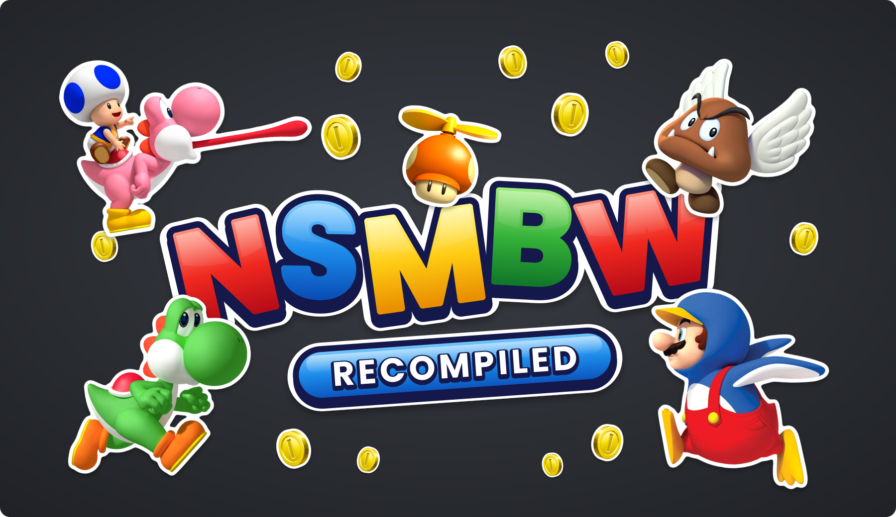

  

# NSMBW Recompiled

A work-in-progress native PC port of the 2009 Wii side-scrolling platformer *New Super Mario Bros. Wii*, made with static
recompilation. It is a fork of [WiiCompiled](https://github.com/patchzyy/Wiicompiled) and reuses
its translator and runtime.

> [!IMPORTANT]
> **Status: planning / pre-alpha. Nothing is playable yet.** This repository currently contains
> the upstream WiiCompiled code plus the plan, the project scaffolding and the tracking issues for
> the port. See the [roadmap](docs/nsmbw/roadmap.md) and the
> [milestones](../../milestones).

> [!IMPORTANT]
> There is no Nintendo code, no assets and no game data anywhere in this project or its releases,
> and there never will be. You need your own legally dumped copy of the game. The translation runs
> on your machine against your own disc image, and nothing is ever uploaded. Read
> [LEGAL.md](docs/LEGAL.md) before contributing.

## Goals

- **Target:** the North American release (game ID `SMNE01`), one pinned revision, verified by
  SHA-256. Other regions and revisions may be added later as separate manifests.
- **Behaviour identical to the console.** Proven by input replays and per-tick state hashes
  compared against Dolphin.
- **Modern rendering.** Internal resolution up to 4K and 8K, and presentation at 360 Hz and above
  through interpolation, while the game logic stays at its original 60 ticks per second.
- **Every controller can play the whole game.** Pads with motion sensors (8BitDo, Switch Pro,
  DualSense, real Wii Remotes) drive tilt and shake; pads without sensors, keyboard and mouse get
  alternative controls (stick or triggers for tilt, a dedicated shake button).
- **Online multiplayer, with friends and with strangers.** The original game has no online mode.
  It is designed in from day one (deterministic simulation, per-tick inputs, state snapshots) and
  implemented late, as input-synchronised rollback netcode.

## Documents

| Document | What it covers |
| --- | --- |
| [docs/nsmbw/roadmap.md](docs/nsmbw/roadmap.md) | Milestones M0 to M9 and their exit criteria |
| [docs/nsmbw/architecture.md](docs/nsmbw/architecture.md) | Target architecture and the seven determinism rules |
| [projects/nsmbw-usa/](projects/nsmbw-usa/) | The translator manifest for the USA release, with every pinned value |
| [LEGAL.md](docs/LEGAL.md) | What must never enter this repository |
| [CONTRIBUTING.md](CONTRIBUTING.md) | Contribution rules (inherited from WiiCompiled) |
| [docs/UPSTREAM-README.md](docs/UPSTREAM-README.md) | The original WiiCompiled README: build instructions, FAQ, credits |

## Building

Until the NSMBW profile exists, building works exactly as upstream: see
[docs/UPSTREAM-README.md](docs/UPSTREAM-README.md#building-from-source) and
[translator/README.md](translator/README.md).

## Relationship with WiiCompiled

This fork tracks upstream `main`. Anything generic (translator fixes, multi-REL support, Wii
Remote emulation improvements, determinism work) is meant to be proposed upstream; issues carrying
the `upstream` label track that. Upstream has its own contribution rules, read them before opening
a pull request there.

## AI usage

AI coding tools are used in this project. Accuracy claims are backed by replay and state-hash
comparisons, not by trust in generated code.

## Credits

All credit for the translator, the runtime and the launcher goes to the
[WiiCompiled](https://github.com/patchzyy/Wiicompiled) authors and the projects they build on
([aurora](https://github.com/encounter/aurora), [Dawn](https://dawn.googlesource.com/dawn),
[Dolphin](https://github.com/dolphin-emu/dolphin)). See
[THIRD-PARTY-NOTICES.md](THIRD-PARTY-NOTICES.md).

## License

GPL-3.0, like WiiCompiled. See [LICENSE](LICENSE).

Not affiliated with, endorsed by, or associated with Nintendo. All trademarks belong to their
owners. No Nintendo intellectual property is contained in, distributed with, or obtainable through
this project.
